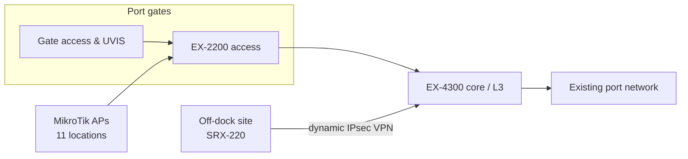

# 02 · Port Access-Control Network & UVIS Integration

**Customer:** Major seaport authority, Bangladesh (access control project)
**Role:** Network design and implementation

## Scope
- Integrated the network and the **UVIS** (Under Vehicle Inspection System) with the existing infrastructure
- Designed and implemented L2 and L3 networks for gate access control
- Set up a **dynamic IPsec VPN** from an off-dock site
- Deployed MikroTik wireless access points at **11 locations**

## Design (simplified)

## Technologies
Juniper EX-2200, EX-4300 · Juniper SRX-220 · dynamic IPsec VPN · VLANs and inter-VLAN routing · MikroTik wireless
