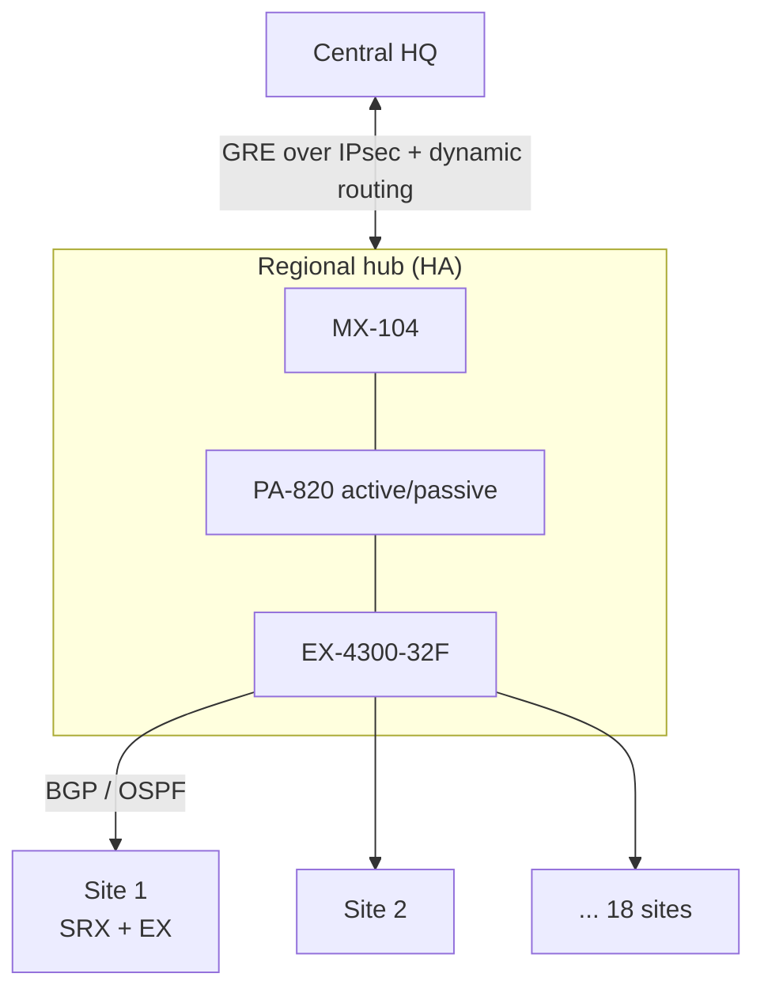

# 03 · Multi-Site Defense WAN Upgrade (18 Sites)

**Customer:** Defense organisation, Bangladesh (regional network upgrade)
**Role:** Planning, design and implementation

## Scope
- Planned, designed and implemented the L2 and L3 network for **18 sites** in a regional zone, connected to a regional hub
- Built **active/passive HA** across the router (MX-104), core switch (EX-4300-32F) and firewall (Palo Alto PA-820)
- Ran **dynamic routing over GRE over IPsec** back to the central headquarters
- Configured PA-820 HA with ACLs and a UTM (threat prevention) bundle

## Design (simplified)

## Technologies
Juniper MX-104, SRX-345, SRX-550, EX-4300, EX-4200, EX-2200 · Palo Alto PA-820 · BGP · OSPF · GRE over IPsec · active/passive HA · ACL and UTM

## Related labs
- SRX route-based VPN with OSPF: [`srx-route-based-ipsec.conf`](https://github.com/mihirchandra10/network-config-templates/blob/main/juniper/srx-route-based-ipsec.conf)
- PAN-OS HA: [`ha-active-passive.set`](https://github.com/mihirchandra10/network-config-templates/blob/main/paloalto/ha-active-passive.set)
