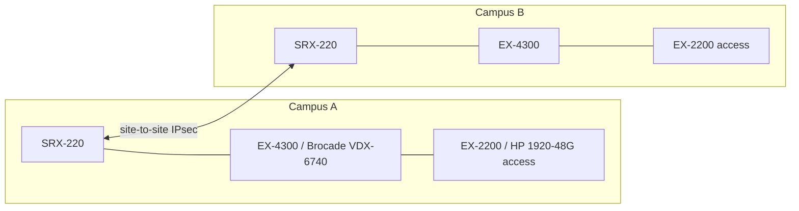

# 06 · Two-Campus Office Network with Zone-Based Security

**Customer:** Government mapping agency, Bangladesh (two office campuses)
**Role:** Design and implementation

## Scope
- Built the L2 and L3 office network at **two campuses**
- Configured zone-based security policies, ACLs and UTM
- Set up a **site-to-site IPsec VPN** between the two campuses

## Design (simplified)

## Technologies
Juniper SRX-220, EX-2200, EX-4300 · Brocade VDX-6740 · HP 1920-48G · security zones · ACL · UTM · IPsec VPN
