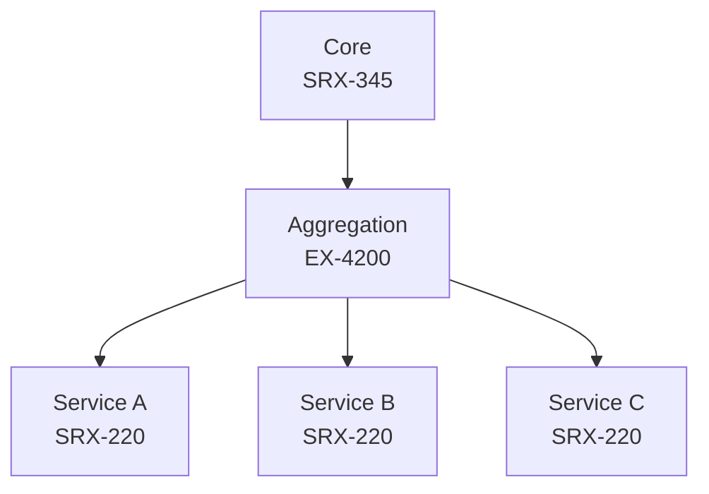

# 08 · Core / Aggregation / Access Network for Video Conferencing

**Customer:** Defense organisation, Bangladesh (tri-service: army, navy and air force)
**Role:** Planning, design and implementation

## Scope
- Planned and built a three-tier **core, aggregation and access** network carrying video-conferencing traffic between the three services
- Configured ACLs and UTM so that each service's network stays separated and secured

## Design (simplified)

## Technologies
Juniper SRX-345, SRX-220, EX-4200 · three-tier network design · ACL · UTM · security zones per service
