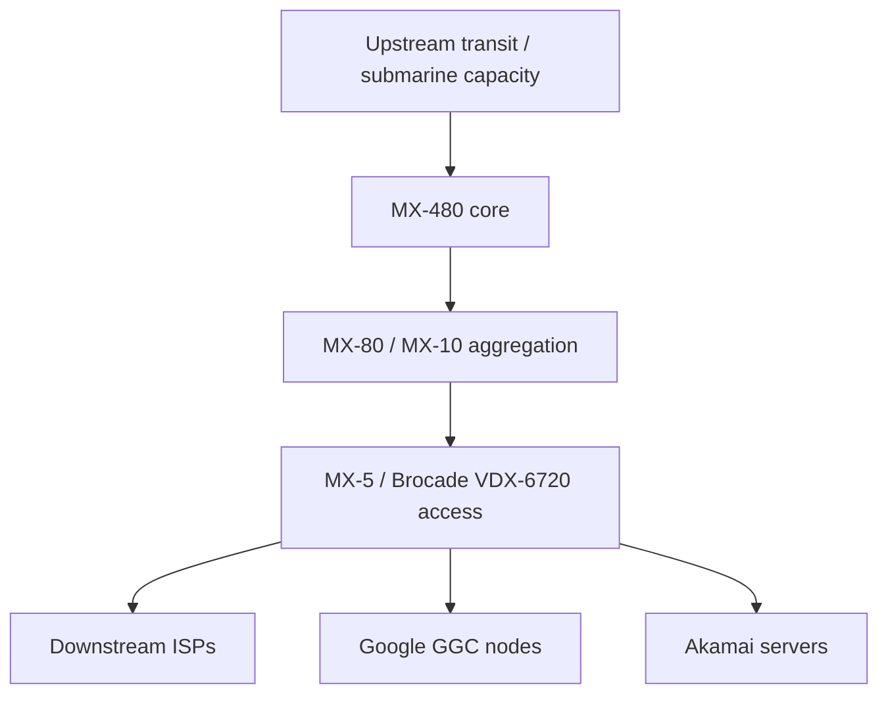

# 10 · Carrier Data Center Build: IIG Core

**Customer:** Earth Telecommunication (Pvt.) Ltd., International Internet Gateway (IIG), Dhaka collocation data center
**Role:** Manager, Core Network (in-house)

## Scope
- Designed and implemented device management across **core, aggregation and access** layers, plus the physical connectivity
- Integrated content-delivery caches: **Google Global Cache (GGC)** nodes and **Akamai** servers
- Day-to-day operation of IIG/ISP routing: static, **BGP**, **MPLS**
- Traffic monitoring and bandwidth/QoS optimisation; network security including firewalls, IDS and **DDoS mitigation**

## Design (simplified)

## Technologies
Juniper MX-480, MX-80, MX-10, MX-5 · Brocade VDX-6720 · BGP · MPLS · CDN cache integration · QoS · DDoS mitigation
